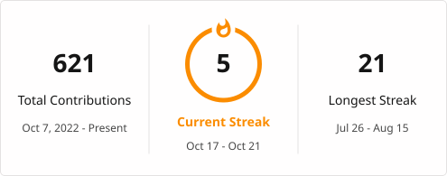

<div align="center">

<pre>

╔══════════════════════════════════════════════════════════════════════════════════════════════════════════════════════════╗
║                                                                                                                          ║
║    ██████╗  ██████╗ ██╗  ██╗ ██████╗   █████╗  ██╗   ██╗     ██████╗  ██████╗ ██╗ ███████╗███████╗███╗   ██╗███╗   ██╗   ║
║   ██╔════╝ ██╔══██╗ ██║  ██║ ██╔══██╗ ██╔══██╗ ██║   ██║    ██╔════╝ ██╔══██╗ ██║ ██╔════╝██╔════╝████╗  ██║████╗  ██║   ║
║   ██║  ███╗███████║ ██║  ██║ ██████╔╝ ███████║ ██║   ██║    ██║  ███╗███████║ ██║ ███████╗█████╗  ██╔██╗ ██║██╔██╗ ██║   ║
║   ██║   ██║██╔══██║ ██║  ██║ ██╔══██╗ ██╔══██║ ╚██╗ ██╔╝    ██║   ██║██╔══██║ ██║ ╚════██║██╔══╝  ██║╚██╗██║██║╚██╗██║   ║
║   ╚██████╔╝██║  ██║ ██████╔  ██║  ██║ ██║  ██║  ╚████╔╝     ╚██████╔╝██║  ██║ ██║ ███████║███████╗██║ ╚████║██║ ╚████║   ║
║    ╚═════╝ ╚═╝  ╚═╝ ╚═════╝  ╚═╝  ╚═╝ ╚═╝  ╚═╝   ╚═══╝       ╚═════╝ ╚═╝  ╚═╝ ╚═╝ ╚══════╝╚══════╝╚═╝  ╚═══╝╚═╝  ╚═══╝   ║
║                                                                                                                          ║ 
║                              Systems and Tooling Engineer · B.Tech CSE · ABV-IIITM GWALIOR                               ║
╚══════════════════════════════════════════════════════════════════════════════════════════════════════════════════════════╝
</pre>

</div>

---

## `CONNECT`

<div align="center">

[](https://gauravgaisenn.vercel.app/)
[](https://github.com/ggaisenn)
[](https://www.instagram.com/gaisenn_talks/)
[](https://www.youtube.com/@gaisenntalks)
[](https://codeforces.com/profile/gaurav_gaisenn)
</div>

---

## `ABOUT`

```yaml
name:       Gaurav Gaisenn
username:   ggaisenn
role:       B.Tech CSE Student
institute:  ABV-IIITM Gwalior, Madhya Pradesh
focus:
  - Systems Programming (C/C++)
  - Real-Time Simulation Engines
  - Developer Tooling (Node.js Scripting, CMake, Docker)
  - Open-Source
open_to:
  - Open-source contributions
```

---

## `PROJECTS`

### [`ThermaSync-EV`](https://github.com/ggaisenn/ggthermalsync) — EV Thermal Simulation & Telemetry Pipeline

```
Language  │ C++17, Node.js, Three.js, Docker
Platform  │ Cross-Platform / Docker Compose
License   │ Apache-2.0
Status    │ Completed · v1.0
```


Real-Time Telemetry Engine simulating EV battery thermal behavior. 
- C++17 physics core with PID cooling logic
- Node.js TCP/WebSocket backend for safety validation and ring-buffer history.
- Three.js/Chart.js 3D browser dashboard.

## Status

| Area | State | Includes |
|---|---|---|
| Core engine | Implemented | 16-cell thermal model, PID cooling control, safety override, TCP telemetry |
| Telemetry backend | Implemented | TCP validation, ring-buffer history, HTTP API, WebSocket stream, safety triggers, simulation controls |
| Dashboard | Implemented | Responsive views, 3D battery/coolant model, rolling charts, cell HUD, alerts, light/dark theme |
| Fault injection | Implemented | Normal and overheat mock streams; Cell chaos scenario with backend and PID verification |
| Docker Compose | Implemented | Engine, backend, and static dashboard services with local networking |

### [`ggcli`](https://github.com/ggaisenn/ggcli) — Custom CLI Tool

```
Language  │ Javascript
Platform  │ URLs: Cross-Platform, Apps: macOS
License   │ Apache-2.0 license
Status    │ Active
```

A CLI tool built using Node.js that enables users to launch web links and local applications.

### Current Status

| Step | Feature                                        | Status  |
| ---- | --------------------------------------------   | ------  |
| 1    | Script binary entry (`bin/index.js`)           |  Done   |
| 2    | Command-line arguments parsing (`arg`)         |  Done   |
| 3    | Custom logging with color themes (`chalk`)     |  Done   |
| 4    | Launcher command logic (`open`)                |  Done   |
| 5    | Configuration file search (`cosmiconfig`)      |  Done   |
| 6    | Global package execution links (`npm link`)    |  Done   |
| 7    | Custom JSON Schema configuration rules         |  Done   |
| 8    | Schema-based verification (`ajv`)              |  Done   |
| 9    | Better validation logs (`better-ajv-errors`)   |  Done   |
| 10   | Namespace debugging flag (`debug`)             |  Done   |
| 11	 | Cross-platform URL format validation	          |  Done   |
| 12	 | Host system local app check (`command-exists`) |  Done   |
| 13   | `www.` protocol handling                       |  Done   |
| 14   | macOS App Launch (e.g., `--open Slack`)        |  Done   |
| 15   | Cross-Platform App launcher                    | Process |
|      |---------- MORE FEATURES COMING SOON -----------|         |


## `TECH STACK`

<div align="center">

**Languages**


**Backend & Networking**


**Frontend & Visualization**


**Tools & DevOps**


</div>

---

## `STATS`

<div align="center">

<br/>

<a href="https://git.io/streak-stats"></a>

</div>

---

## `ROADMAP`

```

2026 ──┼──  [ggthermalsync] EV thermal physics engine & telemetry pipeline
       |    [ggcli] Custom CLI tool
       │    [ggalloc] Custom memory allocator
       │     First open-source PRs merged
       │
```

---

<div align="center">

```
Open to Contributions, PRs
Let's Forge Greatness Together
```

</div>
